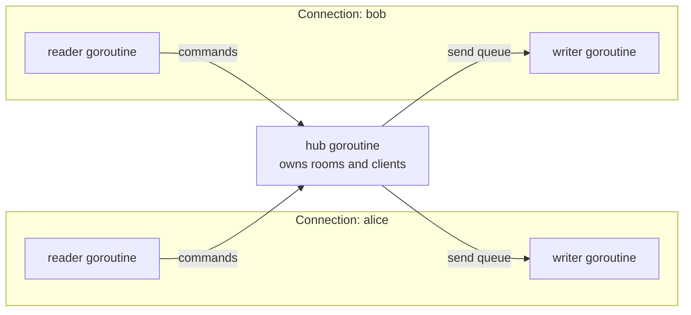

# Go Chat Server

A multi-room chat server and client over TCP, written in Go with the standard library only. Clients join rooms, exchange messages with everyone in the same room, and share files. The server handles many clients at once and keeps all shared state race-free.

## Features

- **Multiple rooms.** A client joins a room on connect and can switch rooms at any time. Messages and files stay within a room.
- **Group chat.** A message is delivered to every other client in the sender's room.
- **File sharing.** A client offers a file to the room (name and size), and the server streams it to the other members, who save it to a downloads folder.
- **Clean disconnects.** When a client leaves or drops, the room is told and its resources are freed.
- **Concurrent and race-free**, verified with Go's race detector.

## Architecture

The server runs three kinds of goroutine. All shared chat state (who is connected, which room they are in) lives on a single **hub** goroutine; everything else talks to it over channels, so no mutex is needed and there is no shared-memory race.



- Each connection has a **reader** goroutine that decodes frames and forwards them to the hub, and a **writer** goroutine that is the only one allowed to write to that socket. Other goroutines reach a client only through its buffered send queue, so writes never race and one slow client cannot block the rest.
- The **hub** receives every register, unregister and command over channels and is the only goroutine that touches the room and client maps.

## Protocol

TCP is a byte stream with no message boundaries, so the protocol frames every message itself:

```
+--------+------------------+--------------------------+
| type   | length (4 bytes) |  payload (length bytes)  |
| 1 byte | big-endian uint  |                          |
+--------+------------------+--------------------------+
```

The one-byte type says how to read the payload, and the length prefix lets chat text and raw file bytes share one connection without ambiguity. Frames are capped at 1 MiB so a bad peer cannot force a huge allocation; files are sent in chunks under that limit.

A session starts with a handshake frame (`JOIN` with payload `<name>\n<room>`). The main message types:

| Direction | Type | Payload | Meaning |
| --- | --- | --- | --- |
| client → server | `JOIN` | `<room>` | join or switch to a room |
| client → server | `CHAT` | text | message to the room |
| client → server | `FILE_OFFER` | `<name>\n<size>` | announce a file |
| client → server | `FILE_CHUNK` | `<name>\n` + bytes | a piece of the file |
| client → server | `LEAVE` / `QUIT` | — | leave the room / disconnect |
| server → client | `INFO` / `ERROR` | text | a notice or an error |
| server → client | `CHAT_FROM` | `<sender>\n<text>` | a message from someone |
| server → client | `INCOMING_OFFER` | `<id>\n<sender>\n<name>\n<size>` | someone is sending a file |
| server → client | `INCOMING_FILE` | `<name>\n` + bytes | file data to save |

The full list is in [`internal/protocol/protocol.go`](internal/protocol/protocol.go).

## Build and run

Requires [Go](https://go.dev/dl/) 1.22 or newer. No external dependencies.

```bash
go build ./...

# start the server
go run ./cmd/server --addr :12345

# in another terminal, connect a client
go run ./cmd/client --name alice --room 1
# and another
go run ./cmd/client --name bob --room 1
```

Client commands:

```
/join <room>    join or switch rooms
/leave          leave the current room
/send <path>    send a file to the room
/quit           disconnect
<text>          send a chat message
```

## Tests

```bash
go test -race ./...
```

The tests start a real server on a loopback port and drive it with real connections: chat broadcast, room isolation, file transfer and room switching, all under the race detector.

## Layout

| Path | Contents |
| --- | --- |
| `cmd/server`, `cmd/client` | Command-line entry points |
| `internal/protocol` | Frame format: encode, decode, message types |
| `internal/server` | Hub, per-client goroutines, rooms, file brokering |
| `internal/client` | Connecting, sending commands, receiving files |

## License

[MIT](LICENSE)
